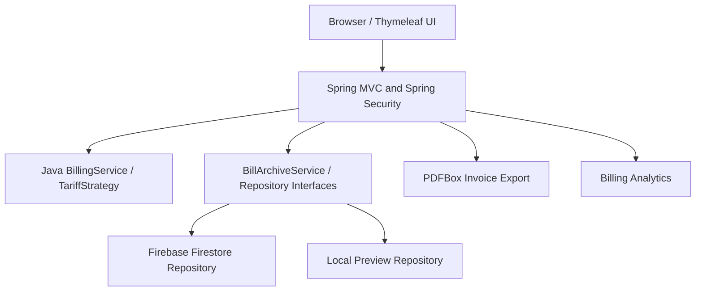

<div align="center">
  

# ⚡ VOLTLEDGER

### Smart Electricity Billing & Energy Analytics

A full-stack **Java OOP** college project with a premium Clean Energy interface, Firestore persistence, accurate tariff calculations, role-based access, energy analytics and downloadable PDFs.

**Java 21** · **Spring Boot 4.1.1** · **Spring Security** · **Thymeleaf** · **Firebase Cloud Firestore** · **PDFBox**

**Current stage: v1.0.0-rc1 — release candidate.** Not yet a verified public production deployment.

### 🌐 Live Deployment

[🚀 Live Demo](https://voltledger-java.onrender.com/)

[💻 GitHub Repository](https://github.com/Animesh-666/VOLTLEDGER)
</div>

---

## What it does

| Module | Capability |
|---|---|
| Java billing engine | Progressive residential/commercial tariff slabs, fixed charges and sample tax using `BigDecimal` |
| Consumer management | Register consumers, prevent duplicate meter IDs, assign meters to accounts |
| Secure access | Spring Security authentication, BCrypt hashes, ADMIN / CONSUMER roles |
| Admin workspace | Manage consumers, create saved invoices, review billing history and analytics |
| Consumer workspace | Review only assigned invoice history and PDF exports |
| Analytics | Last-six-month consumption overview, totals and invoice averages |
| Invoice export | Printable server-generated PDF bills |
| Firestore | Cloud persistence for accounts, consumers, meter index and invoices |
| Preview | Runs locally without Firebase; data is reset on application restart |

> **Demo rates only.** This project does not issue legal utility invoices, handle actual payments or predict future consumption. Rates and tax amounts are illustrative for assessment/demo purposes.

## Architecture



Java OOP concepts: encapsulation (`Consumer`), interfaces / abstraction (`TariffPlan`, `ChargeRule`), polymorphism (residential/commercial plans), constructors, collections and validation. **Tariff arithmetic is server-side Java, never browser-supplied totals.**

## Get started — local Preview Mode

Requirements: JDK 21, Maven 3.9+, Git, VS Code or IntelliJ.

```powershell
java -version
mvn -version
mvn clean verify
mvn spring-boot:run
```

Open **http://localhost:8080/** and use the public calculator. The default Spring profile is `preview` (in-memory storage). For admin testing, set a strong private `VL_BOOTSTRAP_ADMIN_PASSWORD` in the local shell; see `docs/FIREBASE_SETUP.md` and `scripts/start-preview.ps1`.

## Firebase mode — durable cloud records

The existing project contains a Spring Boot Firestore adapter. The Firebase Admin **server key must be stored outside Git**. See [Firebase setup](docs/FIREBASE_SETUP.md), or use the PowerShell helper:

```powershell
./scripts/start-firebase.ps1
```

For manual setup in the same PowerShell terminal:

```powershell
$env:SPRING_PROFILES_ACTIVE = 'firebase'
$env:FIREBASE_PROJECT_ID = 'YOUR_FIREBASE_PROJECT_ID'
$env:GOOGLE_APPLICATION_CREDENTIALS = 'C:\\path-outside-repo\\firebase-service-account.json'
# Use Read-Host -AsSecureString to set a first-run admin password privately.
mvn spring-boot:run
```

Never place a private key, API secret, password, or full service-account JSON inside a public repository or issue screenshot.

## Sample expected calculation

Residential, 275 kWh:

| Part | Value |
|---|---:|
| 100 × ₹4 | ₹400.00 |
| 100 × ₹6 | ₹600.00 |
| 75 × ₹8 | ₹600.00 |
| Fixed charge | ₹75.00 |
| Illustrative 5% tax | ₹83.75 |
| **Total** | **₹1,758.75** |

## Routes

| URL | Access |
|---|---|
| `/` | Public homepage |
| `/calculator` | Public Java bill calculator |
| `/register` | Consumer signup (disabled by default in production) |
| `/login` | Form login |
| `/admin` | Administrator dashboard |
| `/admin/consumers` | Admin consumer/meter management |
| `/admin/bills/new` | Admin bill entry |
| `/account` | Consumer's assigned invoices |
| `/api/live` | Cheap process liveness endpoint |
| `/api/health` | Cached Firestore health check in firebase mode |

## Deployment

- [Render + Firebase step-by-step](docs/DEPLOY_RENDER_FIREBASE.md)
- [Security and environment controls](docs/SECURITY.md)
- [Release test checklist](docs/RELEASE_ACCEPTANCE.md)
- [Release notes](docs/RELEASE_NOTES.md)
- [Java OOP viva guide](docs/VIVA_PREPARATION.md)
- [Architecture notes](docs/ARCHITECTURE.md)
- [College report](docs/COLLEGE_REPORT.md)

A `Dockerfile`, optional `render.yaml` and GitHub Actions workflow are included. The Render production profile must be `firebase,production`; Preview mode is intentionally blocked on Render. Use a private Firebase key via Render **Secret Files**; do not bake credentials into the Docker image.

## Verification

```powershell
mvn clean verify
```

GitHub Actions runs Maven verification on pushes/PRs. A successful local build and live Render smoke test are **not** claimed by this archive; they must be completed before tagging a stable `v1.0.0` release. Use synthetic data for demonstrations, monitor Firestore quotas and add pagination/rate limiting before using with large numbers of accounts.

## License and attribution

Created for Java OOP learning and college demonstration. Third-party libraries have their respective licenses. No software license for re-use is granted unless a `LICENSE` file is added explicitly.
