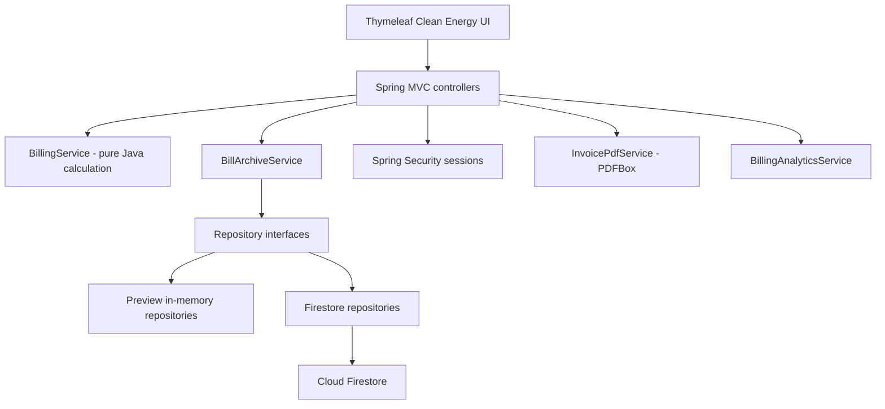

# VOLTLEDGER — Architecture (Java OOP)



## Storage choice

- Default `preview`: Java collections, no external credentials, records disappear on restart.
- `firebase`: Firebase Admin SDK through a service account, using `users`, `consumers`, `meter_index` and `invoices` Firestore collections.
- `production`: supplementary HTTPS cookie/cache configuration, must be paired with `firebase`.
- No MongoDB, PostgreSQL, H2, JDBC or Flyway in this version.

## OOP model

- `Consumer`: encapsulated fields + constructor.
- `TariffPlan`: abstract base class; subclasses `ResidentialTariffPlan` and `CommercialTariffPlan` implement tariff differences (inheritance + polymorphism).
- `ChargeRule`: interface and `PercentageTaxRule` implementation.
- `BillRequest`, `ElectricityBill`, `BillLine`: immutable records.
- `BillingService`: Java `BigDecimal` monetary calculations and slab iteration.
- `BillArchiveRepository` and `UserAccountRepository`: interface-based persistence inversion.

## Firestore document shape

```text
users/{username}: username, displayName, passwordHash, role, enabled
consumers/{consumerId}: consumerId, fullName, address, meterNumber, ownerUsername
meter_index/{sha256(meterNumber)}: consumerId, meterNumber
invoices/{invoiceNumber}: invoiceNumber, generatedOn, consumerId, consumerName,
  consumerAddress, meterNumber, tariffName, consumedUnits, total, tax,
  fixedCharge, energyCharge, subtotal, lines[]
```

Money is serialized to decimal strings to avoid binary floating-point inaccuracies in Firestore. Consumers can access invoices only through the backend ownership check, never by submitting their own username. Invoice lines are embedded and written together with the invoice document. The current history method loads a small collection and filters on the server; add paginated indexed queries for larger deployments.
